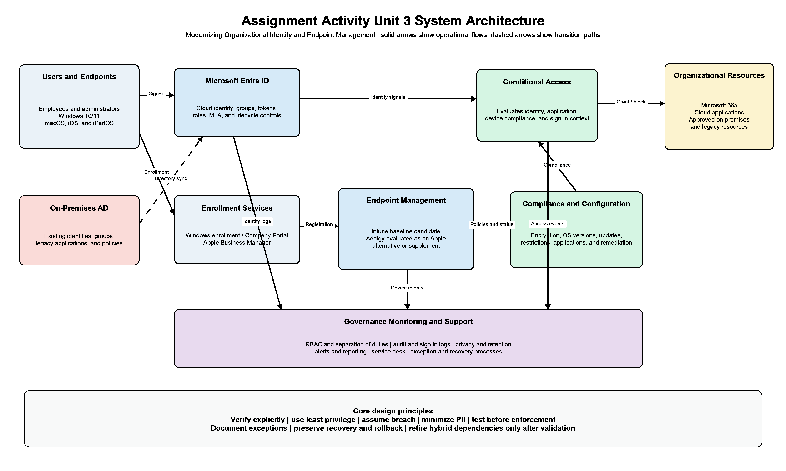

# Modernizing Organizational Identity and Endpoint Management

This repository supports an MSIT capstone project that evaluates how an organization can move from traditional on-premises Microsoft Active Directory toward cloud-based identity and endpoint management while continuing to support Windows, macOS, iOS, and iPadOS devices.

The current baseline uses Microsoft Entra ID for identity and access and Microsoft Intune for Windows, macOS, iOS, and iPadOS management. Apple Business Manager provides organizational assignment, automated enrollment, and application licensing for company-owned Apple devices. Addigy was reviewed as an Apple-focused option, but it is not required in the current baseline. I will reconsider it only if later authorized testing identifies an Apple requirement that Intune cannot meet at an acceptable operational or licensing cost.

## Research gap and design response

Existing sources provide useful but separate guidance. NIST and CISA describe identity assurance, privacy, and zero-trust outcomes, while Microsoft, Apple, and Addigy document platform capabilities. Standards do not prescribe a complete mixed-platform migration, and vendor documentation does not independently compare the products in this organization.

The proposed system addresses that gap by connecting identity lifecycle, authentication, endpoint enrollment, configuration, compliance, Conditional Access, monitoring, privacy, and legacy transition controls. Standards define the expected security and privacy outcomes. Vendor material identifies capabilities that still require requirements-based review or proof-of-concept testing. See [Research Analysis and Design Response](docs/research-analysis.md) for the detailed connection.

## Project objectives

- Document identity, endpoint, security, privacy, compatibility, support, and cost requirements.
- Define the proposed architecture and the interactions among its components.
- Verify the required Apple-management outcomes through Intune and Apple Business Manager and document any remaining gaps.
- Test representative authentication, enrollment, configuration, compliance, and access scenarios.
- Produce a migration roadmap with dependencies, risks, rollback steps, and hybrid exit criteria.

## Repository structure

| Folder | Purpose |
|---|---|
| `src/` | Nonproduction prototype, automated tests, evaluation scripts, and sanitized deployment configuration. |
| `docs/` | Requirements, module specifications, design decisions, risks, test plans, and progress records. |
| `design/` | Editable Draw.io architecture source and exported preview image. |
| `evidence/` | Anonymized evidence index and guidance for approved screenshots or exports. |

The formal Word assignment documents are submitted separately through the course assignment area and are excluded from this repository.

## Architecture

The design connects cloud identity, endpoint enrollment, configuration and compliance, Conditional Access, organizational resources, monitoring, privacy, support, recovery, and a controlled temporary path for legacy dependencies.

## Branches

- `main` contains reviewed milestone work.
- `development` contains changes being prepared for review.
- Larger changes may use focused branches created from `development`.

See [Version Control and Traceability](docs/version-control-overview.md) for the working approach.

## Current status

The problem definition, literature analysis, architecture, module design, requirements, risk review, and version-control structure are complete. The Unit 4 browser prototype demonstrates identity access decisions, endpoint compliance evaluation, and session-only decision logging with sample data. Unit 5 separates the rules into testable functions and adds 16 automated tests with coverage reporting. Unit 6 connects the interface, controller, policy functions, visible results, and session log; it also adds requirement traceability, local performance measurements, a structured usability review, and a Docker/Nginx nonproduction deployment plan. Unit 7 adds repeatable system, integration, and requirement-based acceptance testing plus a maintenance plan. The Unit 7 resubmission executes the container plan, adds ten automated configuration, input, and plain-language guidance checks, seven structural browser-accessibility checks, 400 containerized browser workflow measurements, and image vulnerability scanning and remediation. The established policy suite passes 16 of 16 tests, the additional automated checks pass 10 of 10, and seven of eight original browser cases pass. The remaining case documents that the temporary decision log does not persist after refresh and therefore cannot be treated as organizational audit evidence. The local Nginx image built, became healthy, returned HTTP 200 with the configured security headers, and completed a clean Docker Scout scan after base-image and zlib remediation. A qualitative follow-up with three representative users on October 19, 2026 identified technical terminology as the primary issue for the nontechnical participant. The interface now includes plain-language definitions, result explanations, specific remediation steps, and a visible session-log notice. The working platform baseline remains Entra ID, Intune, and Apple Business Manager. Structured task-based testing with a larger participant group, manual accessibility review, authorized tenant configuration, and vendor-specific testing remain later milestones.

See [Unit 6 Integration, Evaluation, and Deployment Planning](docs/unit6-integration-evaluation-deployment.md) for the measured results, traceability table, deployment boundary, and limitations. The matching sanitized artifacts are listed in the [Unit 6 Evidence Index](evidence/unit6-evidence-index.md).

See [Unit 7 System Testing and Maintenance Plan](docs/unit7-system-testing-maintenance.md) for the complete browser-test matrix, maintenance schedule, risks, and production-readiness path. The matching artifacts are listed in the [Unit 7 Evidence Index](evidence/unit7-evidence-index.md).

## Security and privacy

Do not commit credentials, access tokens, private keys, production exports, personal information, device serial numbers, tenant identifiers, IP addresses, or unredacted screenshots. Use test accounts, nonproduction data, and sanitized evidence.

## Author

Dennis Morales  
MSIT 5910-01 Capstone Project  
University of the People
